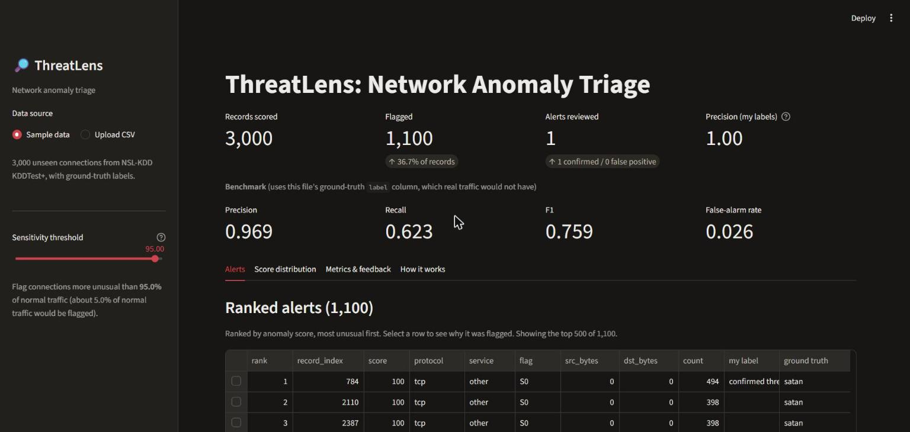
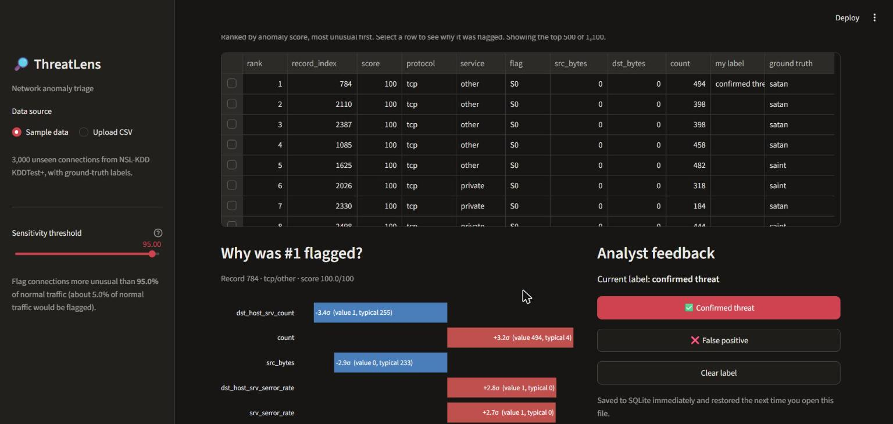

# ThreatLens: Network Anomaly Triage Dashboard

**Student:** Luca Accomando · **Course:** CIS 3400 Advanced Programming · **Project 2** · Final presentation: December 8, 2026

ThreatLens is a Streamlit application that turns an Isolation Forest into a tool a security analyst can
actually use: upload connection records, get a ranked list of suspicious connections, see *why* each one was
flagged, label it as a real threat or a false positive, and have those labels stored in SQLite and used to
measure and tune the detector.



*Figure 1. The running app on the bundled sample: metrics, sensitivity slider, ranked alerts. The top alert has been labeled by the analyst.*



*Figure 2. Selecting an alert shows how far each feature is from normal traffic (here a port scan: one connection to the service out of a typical 255, 494 connections in the window versus a typical 4, zero bytes sent) and lets the analyst label it.*

---

## Deliverable 2 status (November 23)

| | |
|---|---|
| **Working prototype** | Yes. `streamlit run app.py` runs the full loop below on the sample data or an uploaded CSV. |
| **Core interaction demonstrated** | Upload/select data → validation → Isolation Forest scoring → ranked alerts → per-alert explanation → analyst label → saved in SQLite → metrics and threshold suggestion update. Labels persist across page reloads and restarts. |
| **Integration** | Streamlit UI ↔ data loader ↔ saved scikit-learn model ↔ SQLite, all connected and exercised by 38 automated tests plus a manual browser run. |

### Completed and working

- **Data upload and validation** (`src/data_loader.py`): accepts headered CSVs and the original headerless NSL-KDD `.txt` layout; rejects missing columns, non-numeric, negative or missing values with a message naming the column and row; never crashes on empty or binary files.
- **Model training and evaluation** (`src/train.py`): trains on normal traffic, calibrates the score on held-out normal traffic, evaluates on `KDDTest+`, runs an ablation, saves `model/threatlens_model.joblib`.
- **Anomaly scoring and ranking** (`src/model.py`, `app.py`): 0-100 percentile score, sensitivity slider, ranked table, score histogram, precision/recall/F1 curves.
- **Alert explanations**: top deviating features (z-scores) plus rare category values for any selected alert.
- **Analyst feedback loop** (`src/db.py`, `src/metrics.py`): confirm / false positive / clear, stored immediately in SQLite, precision of reviewed alerts, **suggested threshold** from the analyst's labels, alert-history CSV export.
- **Tests and docs**: 38 pytest tests; documents explaining Isolation Forest and every technology used.

### Not finished yet (planned for the Final Deliverable, December 8)

- Short evaluation of the suggested-threshold feature with a realistic attack rate (the sample is 57% attacks; real traffic is far lower), including a second sample file with a low attack rate.
- Recall from analyst labels alone is impossible by design (threats that were never flagged are never reviewed); decide how to present this to users, e.g. optional "review a random sample of unflagged traffic".
- UI polish: keyboard shortcuts for labeling, next/previous alert, wording review of explanations, mobile layout.
- Handling uploads in other log formats (only the NSL-KDD columns are supported).
- Final screenshots, demo video, verification of the install steps on a second machine, and the *Lessons Learned* section.
- Optional stretch: deployment, retraining from saved labels.

### Changes from the Deliverable 1 plan (and why)

| Planned | What I did | Why |
|---|---|---|
| Scale numeric columns | `log1p` transform instead | Isolation Forest splits each feature at a random point of its own range, so linear scaling changes nothing. The log transform does change the splits and improved AUC (ablation below). |
| Tune `contamination` and `n_estimators` | Percentile-calibrated threshold; `n_estimators = 200`, untuned | The threshold is chosen from held-out normal data and the slider, so `contamination` has no role. |
| `notebooks/model_training.ipynb` | `src/train.py` script | Reproducible with one command and testable. |
| "Match or beat F1 ≈ 0.84" | Report F1 at a threshold chosen *without* test labels (0.77), and the oracle F1 separately | The 0.84-style numbers came from a threshold tuned on test labels, which nobody can do in practice (see Results). |
| "Run detection" button | Scores automatically on load; slider updates instantly | Scoring takes about 0.2 s, so a button adds a click for no benefit. |
| Save every scored record | Save a record when the analyst labels it | Keeps the database small; each label stores the full record so history is self-contained. |

---

## How ThreatLens differs from Adaptive Threat Hunt

I have an earlier repository, [Adaptive Threat Hunt](https://github.com/lucaaccomando/adaptive-threat-hunt). It uses the
same dataset (NSL-KDD) and the same algorithm family, so the overlap is real and I want to be explicit about it.

| | **Adaptive Threat Hunt** (earlier) | **ThreatLens** (this project) |
|---|---|---|
| **Kind of work** | Research study | Software application |
| **Question** | *When does a detector catch an attack type it has never seen?* | *How can an analyst triage alerts quickly, trust them, and improve the detector from their own judgement?* |
| **Output** | Tables, plots and a paper | An interactive app with persistent state |
| **Models** | Compares four (Random Forest, Isolation Forest, LOF, One-Class SVM) | One, Isolation Forest, treated as a product component |
| **User** | The researcher, via scripts | A SOC analyst, via a web interface |
| **Data handling** | Fixed benchmark files | Arbitrary uploaded CSVs, validated, with clear errors |
| **Storage** | JSON/PNG result files | SQLite database of runs and analyst labels |
| **Evaluation** | Detection maps, leave-one-attack-out | Live precision of the analyst's labels, threshold suggestion, benchmark metrics when ground truth exists |
| **Tests** | Tests of the research scripts | Tests of validation, scoring, explanations, database persistence, SQL-injection safety |

### What is new in ThreatLens (none of this exists in the earlier repository)

1. **Streamlit web application** with upload, slider, ranked alert table, charts and detail panel (`app.py`).
2. **Input validation layer** that turns bad files into actionable messages (`src/data_loader.py`).
3. **A 0-100 anomaly score with a meaning**: percentile of held-out normal traffic, so the slider is a false-alarm control (`src/model.py`).
4. **Per-alert explanations**: z-score deviations and rare-category detection (`explain_records`).
5. **SQLite persistence and feedback loop**: runs, labels, restart-safe history, CSV export (`src/db.py`).
6. **Threshold suggestion from analyst labels** (`suggest_threshold` in `src/metrics.py`).
7. **Packaged, saved model** loaded at start-up with a version check, instead of training inside experiment scripts.
8. **Automated tests for the application layers** (38 tests).

### What I reused from the earlier work

- The NSL-KDD dataset and the Isolation Forest family of detectors.
- Two lessons: (a) pick the threshold on data separate from the test set, never on test labels, and (b) Isolation
  Forest results depend on the feature transform. In ThreatLens I re-measured (b) on NSL-KDD rather than assuming it
  (ablation below); the effect here is smaller than I saw on CIC-IDS2017 in the earlier project.
- No code was copied; the model code here was written for this application.

---

## Why Isolation Forest

Isolation Forest builds many random decision trees that repeatedly split the data on a random feature at a random value.
**Unusual points are isolated after very few splits; typical points need many.** The average number of splits needed
to isolate a connection is its anomaly score (shorter = more anomalous). It fits ThreatLens because:

- it is **unsupervised**: it learns "normal" and needs no labeled attacks, which analysts rarely have;
- it can flag **attacks it has never seen**, because it models normal behaviour rather than specific attacks;
- it gives a **continuous score**, which a ranked list and a threshold slider need;
- it is **fast and compact** (scores 22,544 connections in about 0.2 s; the saved model is about 0.5 MB);
- it needs **no feature scaling** and copes with 41 mixed features.

Weaknesses, which ThreatLens states openly: it cannot explain individual scores (so I add an approximate explanation),
it misses attacks that look like normal sessions (my earlier study found normal-only Isolation Forest recalled 17% of
held-out R2L and 24% of U2R attacks), and its raw score has no natural unit (so I convert it to a percentile).
Full explanation with the formula, diagrams and parameter choices: **[docs/ISOLATION_FOREST.md](docs/ISOLATION_FOREST.md)**.
Every other technology: **[docs/TECHNOLOGY_GUIDE.md](docs/TECHNOLOGY_GUIDE.md)**.

---

## Application features

1. **Data upload and validation**: upload a CSV (NSL-KDD columns) or use the bundled sample; errors name the column and row.
2. **Anomaly scoring and ranking**: sensitivity slider (flag connections more unusual than X% of normal traffic), ranked table, score histogram.
3. **Alert explanations**: the features furthest from normal traffic, plus rare category values.
4. **Analyst feedback and metrics**: confirm / false positive labels in SQLite, precision of reviewed alerts, suggested threshold, history export.

## Technologies used

| Technology | Purpose |
|---|---|
| Python 3.12 | Language |
| Streamlit 1.67 | Web interface |
| pandas / NumPy | Loading, validating, transforming records; math |
| scikit-learn 1.9 | `IsolationForest`, `Pipeline`, `OneHotEncoder`, `FunctionTransformer` |
| joblib | Saving and loading the trained model |
| SQLite (`sqlite3`) | Runs and analyst labels |
| Plotly | Charts |
| pytest | Automated tests |
| External APIs | None. Everything runs locally. |

## Architecture


*Figure 3. Architecture from Deliverable 1; the implementation follows it, with the differences listed in "Changes from the plan" (the offline step is `src/train.py`, not a notebook).*

1. The user uploads a CSV or selects the sample; Streamlit passes the bytes to `data_loader.py`, which validates them.
2. `model.py` scores every record with the saved pipeline (log transform, one-hot encoding, Isolation Forest) and converts raw scores to 0-100.
3. Records at or above the threshold are ranked; for the selected alert `model.py` computes the explanation.
4. When the analyst labels an alert, `db.py` writes it to SQLite; `metrics.py` recomputes precision and the suggested threshold.

**Data.** NSL-KDD (University of New Brunswick), 41 features per connection. The model trains only on normal connections in `KDDTrain+`
(67,343). `KDDTest+` (22,544 connections, 57% attacks, includes attack types absent from training) is used only for evaluation. The
bundled `data/sample_nslkdd.csv` is 3,000 random rows of `KDDTest+`. The `label` column is never a model input.

**Database.** `runs(run_id, filename, file_sha256, n_records, threshold, created_at)`; `alerts(id, run_id, record_index, score, flagged, top_features, record_json, analyst_label, labeled_at)`.
A run is identified by the file's hash, so re-uploading the same file finds its earlier labels.

## Project structure

```text
├── app.py                      # Streamlit interface
├── src/
│   ├── data_loader.py          # CSV loading, validation, error messages
│   ├── model.py                # pipeline, calibrated score, explanations, save/load
│   ├── metrics.py              # precision/recall/F1, threshold sweep, threshold suggestion
│   ├── db.py                   # SQLite schema and queries
│   └── train.py                # train + evaluate + ablation, writes model/
├── model/
│   ├── threatlens_model.joblib # trained model (committed so the app runs after a clone)
│   └── metrics.json            # evaluation numbers quoted below
├── data/sample_nslkdd.csv      # 3,000 unseen connections with ground-truth labels
├── scripts/make_sample.py      # how the sample was produced
├── tests/                      # 38 pytest tests
├── docs/                       # Isolation Forest explainer, technology guide, diagrams, screenshots
├── requirements.txt · requirements-dev.txt · pytest.ini
```

## Installation and running

Requires Python 3.12. No API keys or accounts are needed. The model is included, so you do not need the full dataset.

```bash
git clone https://github.com/lucaaccomando/deliverable2.git
cd deliverable2
python -m venv .venv
.venv\Scripts\activate          # macOS/Linux: source .venv/bin/activate
pip install -r requirements.txt
streamlit run app.py
```

The SQLite file `threatlens.db` is created on first run and is excluded from git.

Optional:

```bash
pip install -r requirements-dev.txt && python -m pytest        # run the tests
# retrain (needs KDDTrain+.txt and KDDTest+.txt in data/raw/, from https://www.unb.ca/cic/datasets/nsl.html)
python -m src.train
```

Tip for a demo: move the threshold slider to about 60, open **Metrics & feedback**, expand *Demo shortcut* and click *Simulate review*,
then *Apply suggested threshold*.

## Results

All numbers are from `model/metrics.json` (reproduce with `python -m src.train`). Test set: `KDDTest+`, never used for training or calibration.

| Measure | Value |
|---|---|
| ROC AUC (threshold-free) | **0.949** |
| At the app default (score ≥ 95): precision / recall / F1 | 0.971 / 0.638 / **0.770** |
| False-alarm rate at the default | 0.025 (8,193 threats found, 243 false alarms) |
| "Oracle" F1, threshold tuned on the test labels | 0.891 at score ≥ 52, but with a **32% false-alarm rate** |

**Reading these honestly.** The 0.84 figure in my proposal was a best-case number from a threshold tuned on test labels. A real analyst has no test
labels, so ThreatLens reports F1 at a threshold chosen from normal traffic (0.77). The oracle row shows that a lower threshold finds nearly every
attack (recall 0.999) but only by flagging a third of normal traffic, so it is a different trade-off, not a better detector. This is the reason the
app has a slider and a feedback loop. Also, 57% of `KDDTest+` is attacks; with realistic attack rates precision would be much lower.

**Feedback loop demonstration (sample file).** Starting at threshold 60, a simulated analyst labels 40 random flagged alerts. ThreatLens suggests
threshold 80.2. Applying it moves the benchmark F1 on the 3,000-row sample from 0.759 (threshold 95) to 0.864 (precision 0.905, recall 0.827, false-alarm rate 0.116).
Caveats: the simulated analyst uses ground truth, the sample is 57% attacks, and I ran this once, so treat it as a demonstration that the mechanism works, not as a measured improvement.

**Ablation: does each preprocessing step earn its place?** (same data and seed; threshold 95)

| `log1p` | one-hot categoricals | AUC | F1 | False-alarm rate |
|---|---|---|---|---|
| no | no | 0.929 | 0.771 | 0.022 |
| yes | no | 0.943 | 0.772 | 0.024 |
| no | yes | 0.942 | 0.777 | 0.031 |
| **yes** | **yes (shipped)** | **0.949** | 0.770 | 0.025 |

Both steps raise AUC (the ranking quality) by about 0.01 each, and F1 at the fixed threshold barely changes. The effect is modest on this dataset, and this is a single seed.

## Testing and validation

`python -m pytest` → **38 passed**. Browser run (Chrome, `streamlit run app.py`) performed on November 23, 2026.

| Test | Expected | Actual |
|---|---|---|
| Sample CSV loads and scores | 3,000 records scored, ranked alerts shown | Passed (automated + browser): 1,100 flagged at threshold 95 |
| Original headerless `KDDTest+.txt` layout | Accepted | Passed |
| Missing columns | Error listing the columns, no crash | Passed: `2 required column(s) are missing: service, src_bytes…` |
| Non-numeric / negative / missing values | Error naming column and data row | Passed |
| Empty file, header-only file, binary garbage | Clean validation error | Passed |
| Unseen `service` value | Scored without error; listed as rare in the explanation | Passed |
| Move slider | Flagged count changes | Passed: 1,100 → 1,938 at threshold 60 |
| Label an alert, reload the page | Label still saved, metrics reflect it | Passed in browser (label and "1 reviewed" survived a full reload); also tested across database connections |
| Hostile text in filename/fields (`'); DROP TABLE alerts; --`) | Stored as data, tables intact | Passed |
| Invalid label value | Rejected by code and by the database `CHECK` constraint | Passed |
| Saved model with a different scikit-learn version | Refuse to load, with instructions | Passed |
| Evaluate on `KDDTest+` | Report metrics vs. baseline | Done: see Results |

**Known limitations.** Only NSL-KDD columns are supported. NSL-KDD is old (derived from 1998 DARPA traffic) and simulated. The explanation compares features
one at a time and is not what the forest literally used. About 5% of connections score exactly 100 (the scale saturates); ranking within them uses the raw score.
Streamlit's dataframe selection state was only checked by hand in the browser, not by the automated tests. The saved model only loads with scikit-learn 1.9.1.
The phrase "about X% of normal traffic would be flagged" is exact on the calibration data; on `KDDTest+` the actual false-alarm rate at 95 was 2.5%.

## AI-assisted development disclosure

**AI tool used:** Claude Code (Anthropic, model Claude Sonnet 5.5).

**How AI was used:** In Deliverable 1 it was used to suggest project topics that already a lot of documentation and available data online. In Deliverable 2, it was used to suggest library use and debugging. Testing was also done by Claude Code.

**Student contributions:** I chose the topic. Researched the information. I wrote most of the code.

**Student statement:** "I reviewed, tested, and can explain the code and technologies used in my application, including code developed with AI assistance."

## Challenges and lessons learned so far

1. **A threshold needs honest data.** Early numbers look better when the threshold is tuned on test labels (F1 0.89 vs 0.77). I switched to a threshold chosen from held-out normal traffic and report the oracle separately. This is the main reason for the feedback loop.
2. **The raw score is meaningless to a user.** Converting it to a percentile of normal traffic makes the slider interpretable, but it saturates at 100 for about 5% of connections, so ranking uses the raw score as a tie-breaker.
3. **Near-constant features break z-scores.** Many NSL-KDD features are almost always 0 in normal traffic, so any non-zero value had an enormous z-score. I floor the standard deviation at 0.25 on the log scale. That floor is a judgement call I have not tuned.
4. **Streamlit re-runs the whole script.** Labels are written from button callbacks so the table and metrics are already up to date on the re-run; the model is loaded once with `st.cache_resource` and scoring is cached on the file bytes.
5. **Testing found a real UI bug** (mixed text and numbers in one table column) that unit tests would not have caught.

*Final lessons learned: to be completed in the Final Deliverable.*

## Project links

- **GitHub repository:** https://github.com/lucaaccomando/deliverable2
- **Earlier related project:** https://github.com/lucaaccomando/adaptive-threat-hunt
- **Deployed application:** not planned (local SQLite storage would not persist on free hosting)
- **Demonstration video:** to be added

## Documentation timeline

- **Deliverable 1 (Nov 16):** proposal, planned features, architecture.
- **Deliverable 2 (Nov 23):** this README updated to reflect the working prototype, measured results and honest status.
- **Final (Dec 8):** remaining work above, final screenshots, verified setup, lessons learned.
