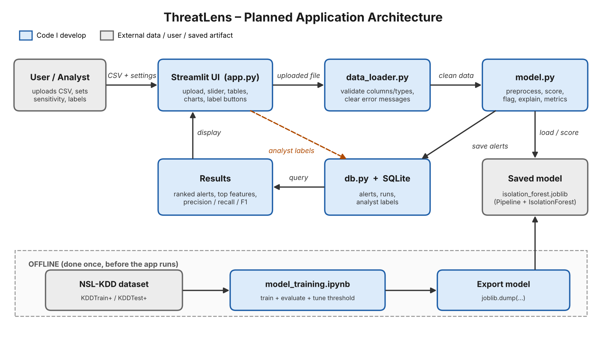
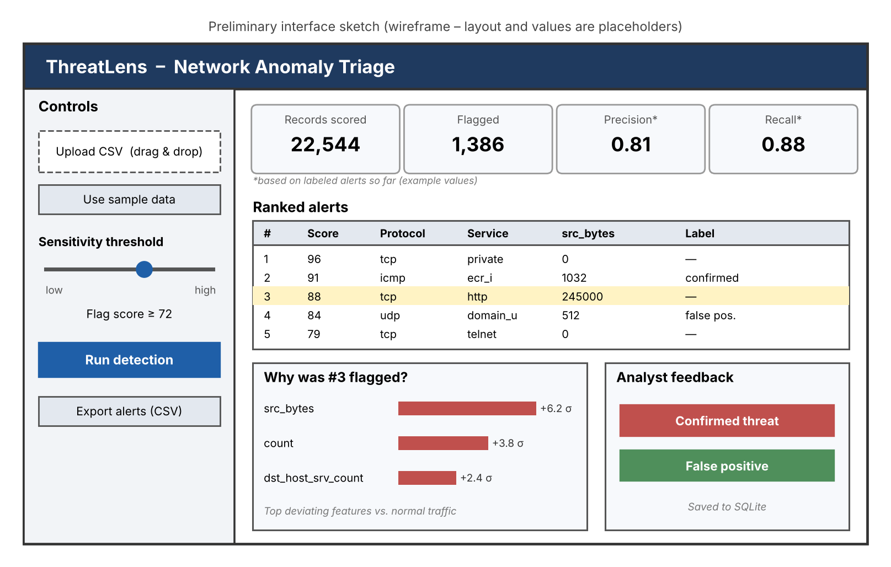

# CIS 3400 – Advanced Programming
## Project 2: Python Application Development

**Student Name:** Luca Accomando  
**Project Title:** ThreatLens – Network Anomaly Triage Dashboard  
**Course:** CIS 3400 – Advanced Programming  
**Final Presentation:** December 8, 2026

> **Status: Deliverable 1 (Proposal & Design, due November 16).** Sections 1–5 are the plan. Sections 6–12 are placeholders that will be completed in Deliverable 2 (November 23) and the Final Deliverable (December 8). Plans may change as development progresses.

---

## 1. Project Overview

**Application Name:** ThreatLens

**Project Option:** Predictive ML Application (with a small SQLite database for saving analyst feedback)

### Problem Statement
Security analysts receive far more network alerts than they can investigate, and most rule-based alerts are false positives. Unsupervised anomaly detection can surface unusual traffic without labeled attack data, but in practice it usually lives in a notebook that outputs one metric and nothing an analyst can act on. ThreatLens turns an anomaly-detection model into a usable tool: an analyst uploads network connection records, receives a ranked list of suspicious connections with a plain-language reason for each, and records whether each alert was a real threat. That feedback is stored and used to measure and tune the detector over time. The goal is to reduce the time spent on false alarms and make model behavior visible to the person who has to trust it.

### Intended Users
- **Primary users:** Junior SOC (security operations center) analysts and students learning threat hunting, who need to triage connection logs quickly.
- **What they accomplish:** Upload a CSV of connection records, adjust detection sensitivity, review ranked anomalies and the features that made each one unusual, label alerts as *confirmed threat* or *false positive*, and see how precision and recall change with their labels.

### Unique Features
- **Not a classroom notebook:** It is a complete application with input validation, a saved model, persistent storage, and a user interface, not a single train/test split.
- **Explainable alerts:** Each flagged connection shows the top features that deviate most from normal traffic, so the analyst knows *why* it was flagged.
- **Analyst feedback loop:** Labels are saved in SQLite and used to compute live precision/recall at the chosen threshold and to suggest a better threshold.
- **Builds on earlier work:** It extends my earlier Isolation Forest experiments on the NSL-KDD benchmark (F1 ≈ 0.84), which became the baseline to match or beat. The new work is the application, explanations, and feedback loop around the model.

## 2. Application Features

- **Feature 1 – Data upload and validation:** The user uploads a CSV of connection records (NSL-KDD column format) or loads the built-in sample data. The app checks the columns, data types, and missing values and shows a clear error message if the file is wrong.
- **Feature 2 – Anomaly scoring and ranking:** A pre-trained Isolation Forest scores every connection. A sensitivity slider sets the flagging threshold, and the app shows a ranked table of flagged connections plus a score distribution chart.
- **Feature 3 – Alert explanations:** For each flagged connection, the app lists the top 3–5 features that are furthest from the normal-traffic baseline (for example, `src_bytes` or `count` far above typical values).
- **Feature 4 – Analyst feedback and metrics:** The analyst marks alerts as *confirmed* or *false positive*. Labels are saved in SQLite, and the app shows precision, recall, and F1 for the labeled alerts and a suggested threshold. Alert history can be exported to CSV.

**How users interact:** The user opens the app, uploads or selects data, moves the sensitivity slider, reviews the ranked alerts and explanations, and labels alerts. They receive a ranked alert table, charts, per-alert explanations, and updated metrics. Saved labels remain available the next time the app starts.

## 3. Technologies Used

These are the technologies **planned**. The list will be updated to what is actually used in Deliverable 2.

| Technology | Purpose |
|---|---|
| Python 3.11+ | Main programming language |
| Streamlit | Web interface (file upload, slider, tables, charts) |
| Pandas / NumPy | Loading, validating, and transforming connection records |
| scikit-learn | Isolation Forest model, preprocessing pipeline (scaling, one-hot encoding), precision/recall/F1 |
| joblib | Saving and loading the trained model and preprocessing pipeline |
| SQLite (`sqlite3`) | Storing scored alerts and analyst labels |
| Plotly (or Streamlit charts) | Score distribution and metrics charts |
| pytest | Automated tests for the data, model, and database functions |
| External APIs | None planned (an optional stretch goal is listed in Section 12) |

## 4. Application Architecture



*Figure 1. Planned architecture. Blue components are code I will write; gray components are external libraries or data.*

### How the Application Works

1. The user uploads a connection-record CSV or selects the sample data in the Streamlit interface.
2. Streamlit passes the file to `data_loader.py`, which validates columns and types.
3. `model.py` applies the saved preprocessing pipeline and scores every record with the Isolation Forest.
4. Records above the sensitivity threshold are flagged, and `model.py` computes the top deviating features for each one.
5. The ranked alerts, charts, and explanations are displayed to the user.
6. When the analyst labels an alert, `db.py` saves the label in SQLite, and the metrics and suggested threshold are recalculated and displayed.

### Data, Model, and API Plan

**Data**
- **Source:** The NSL-KDD benchmark dataset (University of New Brunswick, Canadian Institute for Cybersecurity), an improved version of KDD Cup '99 with duplicate records removed. It has 41 features per connection (3 categorical: `protocol_type`, `service`, `flag`) and a label of `normal` or an attack type.
- **Use:** The `KDDTrain+` file trains the model, and `KDDTest+` is held out for evaluation. The label column is used only for evaluation and for pre-filling demo feedback, never as a model input.
- **Repository size:** Only a small sample (a few thousand rows, `data/sample_nslkdd.csv`) will be committed. The README will explain where to download the full dataset.

**Model**
- **Algorithm:** Isolation Forest (unsupervised), trained mostly on normal traffic. The anomaly score is converted to a 0–100 scale so the slider is easy to understand.
- **Preprocessing:** One-hot encoding for the 3 categorical columns (with `handle_unknown="ignore"`) and scaling for numeric columns, saved as one scikit-learn `Pipeline`.
- **Training:** Done offline in `notebooks/model_training.ipynb`. The app only loads `model/isolation_forest.joblib`, so it starts quickly.
- **Evaluation target:** Match or beat F1 ≈ 0.84 on `KDDTest+`, then report precision, recall, and the effect of threshold choice.
- **Explanations:** For each flagged record, compute how many standard deviations each numeric feature is from the normal-traffic mean (stored with the model) and show the largest few.

**Database (SQLite)**
- `alerts(id, run_id, record_index, score, flagged, top_features, analyst_label, labeled_at)`
- `runs(run_id, filename, threshold, created_at)`

**APIs:** No external APIs are required. All scoring runs locally.

## 5. Project Structure

Planned structure (will be updated to the actual files):

```text
Project_2_Fall_2026_Advanced_Programming/
├── app.py                        # Streamlit interface and page layout
├── src/
│   ├── data_loader.py            # CSV loading, schema validation, error messages
│   ├── model.py                  # Load model, score records, compute explanations, metrics
│   └── db.py                     # SQLite setup, save/load alerts and labels
├── model/
│   └── isolation_forest.joblib   # Trained preprocessing pipeline + Isolation Forest
├── notebooks/
│   └── model_training.ipynb      # Training and evaluation on NSL-KDD
├── data/
│   └── sample_nslkdd.csv         # Small sample for demos and tests
├── tests/
│   └── test_pipeline.py          # pytest tests for loader, model, and database
├── docs/
│   ├── architecture.png          # Figure 1
│   └── interface-sketch.png      # Figure 2
├── requirements.txt
└── README.md
```

## 6. Installation and Running the Application

*To be completed in Deliverable 2 once the app runs.* Planned steps:

```bash
git clone https://github.com/[username]/Project_2_Fall_2026_Advanced_Programming.git
cd Project_2_Fall_2026_Advanced_Programming
pip install -r requirements.txt
streamlit run app.py
```

No API keys or secrets are needed. The SQLite database file is created automatically on first run and is excluded from the repository by `.gitignore`.

## 7. Testing and Validation

*Planned tests; the "Actual Result" column will be filled in as the application is built.*

| Test | Expected Result | Actual Result |
|---|---|---|
| Upload valid sample CSV | Records scored and ranked alerts displayed | To be completed |
| Upload CSV with missing or wrong columns | Clear error message listing the problem columns, no crash | To be completed |
| Unseen category value (e.g., a new `service`) | Handled without error | To be completed |
| Move sensitivity slider | Number of flagged alerts changes accordingly | To be completed |
| Label an alert, then restart the app | Label is still saved and metrics reflect it | To be completed |
| Evaluate on `KDDTest+` | F1 reported and compared to the 0.84 baseline | To be completed |

Known limitations will be documented here after testing.

## 8. AI-Assisted Development Disclosure

**AI Tools Used:** Claude (Anthropic). Other tools to be added if used.

### How AI Was Used

For Deliverable 1, Claude was used to help draft this README from the course template and to generate the architecture and interface-sketch diagrams. This section will be updated with specifics (design, coding, debugging, testing) as development continues.

### Student Contributions

*To be completed as the project progresses: design decisions, code written and modified, integration, testing, and debugging.*

**Student statement:** I reviewed, tested, and can explain the code and technologies used in my application, including code developed with AI assistance.

## 9. Challenges and Lessons Learned

### Anticipated Challenges

**Challenge 1 – False positives from an unsupervised model.** NSL-KDD's test set has a different attack distribution than its training set, so Isolation Forest may flag too many normal connections. *Plan:* make the threshold adjustable, evaluate several `contamination` and `n_estimators` settings in the notebook, and report precision and recall at each threshold instead of a single number.

**Challenge 2 – Categorical features and unseen values.** Uploaded files may contain protocol, service, or flag values that were not in the training data. *Plan:* use a single saved `Pipeline` with `handle_unknown="ignore"` and validate the schema before scoring.

**Challenge 3 – Explaining an unsupervised model.** Isolation Forest does not provide feature importance for individual predictions. *Plan:* use a simple, transparent z-score comparison against the normal-traffic baseline and describe it honestly as an approximation.

**Challenge 4 – Streamlit reruns and state.** Streamlit reruns the script on every interaction, which can reload the model or lose labels. *Plan:* use `st.cache_resource` for the model, `st.session_state` for the current run, and write labels to SQLite immediately.

**Challenge 5 – Persistence if deployed.** Free hosting such as Streamlit Community Cloud may reset local files, which would erase the SQLite database. *Plan:* develop and demo locally first; if deployed, document that stored labels are not guaranteed to persist.

**Challenge 6 – Time.** The final presentation is December 8. *Plan:* build Features 1–2 first (a working end-to-end app), then Features 3–4, and treat the optional items in Section 12 as stretch goals.

### Lessons Learned

*To be completed in the Final Deliverable.*

## 10. Application Screenshots

### Preliminary Interface Sketch



*Figure 2. Wireframe of the main screen: sidebar controls on the left, metrics and ranked alert table on the right, with an explanation panel and labeling buttons for the selected alert.*

### Final Screenshots

*To be added in the Final Deliverable (at least two, with captions): (1) main interface, (2) a working feature with results.*

## 11. Project Links

**GitHub Repository:** [Add the URL of my own repository]  
**Deployed Application:** Not planned yet  
**Demonstration Video:** To be added if applicable

## 12. Future Improvements

1. Retrain or fine-tune a supervised re-ranker using the saved analyst labels.
2. Optional LLM-generated plain-language summaries of each alert (would require an API key stored in an environment variable, never committed).
3. Support additional datasets or live log formats beyond NSL-KDD.

---

### Documentation Timeline

- **Deliverable 1 – November 16:** Complete the project overview, planned features, proposed technologies, preliminary architecture diagram, and planned project structure. These are planning sections and may change as development progresses.
- **Deliverable 2 – November 23:** Update the README to reflect implementation progress and initial testing.
- **Final Deliverable – December 8:** Complete all sections, verify setup instructions, add screenshots, and provide final links.
